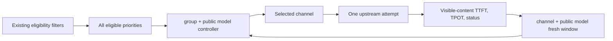

# Dynamic model routing

## Goal

Improve streaming user experience by adapting routing for each public model from
fresh `channel + model` TTFT and TPOT observations, while preserving the existing
channel eligibility, priority, weight, and retry contracts.

The feature is disabled by default. Disabled mode must be behaviorally identical
to the existing static selector.

## Identity and scope

- Observation identity: `channel_id + public_model`. It deliberately does not
  include an endpoint class, user, token, session, or group.
- Allocation identity: `group + public_model`, because eligible channels and
  effective priority/weight are group-specific.
- Only fresh samples count. A window is bounded by both `max_samples` and
  `max_age`; neither bound substitutes for the other.
- Missing TTFT or TPOT is unknown, not zero. Client-caused validation failures do
  not reduce channel health.
- Existing request-path, video-resolution, asset-replica, channel-status, model
  mapping, and specific-channel constraints run before dynamic scoring.
- Dynamic scoring is limited to streaming text-generation routes, where visible
  TTFT and TPOT can actually be measured. Non-streaming, embedding, image,
  audio, realtime, and asynchronous task routes retain the static selector and
  affinity behavior.
- When dynamic routing is active for an eligible request, channel affinity is
  intentionally bypassed so a stale pin cannot keep traffic on a degraded
  channel.

## Runtime path



The dynamic controller is used for both the initial selection and eligible
retries. A retry evaluates the same complete candidate set and health state but
excludes channels already attempted by that request; this avoids retrying the
same dynamically promoted channel and does not mutate the route's global
candidate fingerprint. A specific-channel request bypasses both dynamic
selection and observation.

## Control behavior

1. Cold start sends primary traffic to the highest static priority and reserves
   a small probe share for lower-priority candidates.
2. A lower-priority candidate may receive production traffic only after enough
   fresh observations establish that it is usable.
3. TTFT and TPOT degradation can promote lower-priority candidates. Static
   weight remains a capacity prior when distributing traffic among similarly
   healthy candidates.
4. Severe degradation sheds traffic faster than mild degradation. Hard upstream
   failures can eject a candidate immediately after a small configurable streak.
5. Recovery is slower than shedding and uses hysteresis/cooldown to prevent
   route flapping.
6. The controller distributes across multiple healthy candidates; it must not
   impose a single-channel throughput ceiling.
7. `aggressiveness` controls the severity-to-shedding response. It is not a fixed
   percentage-point-per-minute rate.

Hard failure is a separate state from ordinary TTFT/TPOT degradation. It
immediately removes production share, holds the channel out for a cooldown,
then grants only a small reprobe share. Recovery requires a fresh successful
metric streak after the hard-failure cooldown; old in-flight completions cannot
clear the ejection.

## Discount-first pools

The explicit `discount` pool strategy is separate from `priority` and `smart`;
existing pools keep their strategy. It applies to eligible streaming text
requests and uses the same retry, capacity, hard-failure cooldown, observation,
and weighted-fair selection mechanisms. Non-streaming and media requests keep
the pool's priority routing.

For comparable model price bases, configured lower cost multipliers rank first.
Model-specific discounts override channel defaults; a configured zero is valid,
while missing or invalid discounts rank after every configured value. Within
one discount tier, priority and weight decide the primary allocation. Other
channels share the existing exploration budget.

Each pool sets `max_ttft_ms` (default 15000, range 1–3600000) and `max_tpot_ms`
(default 200, range 1–60000). A more expensive channel being faster alone does
not move traffic away from a primary meeting these limits. Observed quality
violations move traffic to the cheapest verified non-degraded tier. Hard
failures can fail over before verification. The former cheap primary keeps a
small recovery share unless ejected by a hard failure.

These are quality limits evaluated from completed observations, not per-request
timeouts; the existing upstream timeout settings remain in effect.

Recovery uses the existing hysteresis and cooldown, gradually targeting the
cheapest usable tier again. Discount/limit edits rebuild allocation targets
without dropping current hard-failure ejections. Discount and smart strategies
have separate allocation state but share channel/model observations.

The two additive integer columns preserve existing rows and revisions. Routing
uses the discount metadata only; customer charging and upstream cost accounting
are unchanged. No request-time query is issued per individual candidate:
discount metadata is fetched in two bulk reads using the matched ability model,
including normalized model fallback and current model-specific overrides.

### Discount strategy verification (2026-11-06)

- Real database matrix: SQLite 3.50.4, MySQL 8.0.46, and PostgreSQL 16.15.
  Fresh tables and upgrades from the pre-discount pool schema passed, with
  repeated migrations, preserved rows/revisions/composite uniqueness, default
  limits, stale revision rejection, API persistence/filtering, cached and
  uncached selection, model-specific zero discounts, model modifiers, retry
  exclusion, and static routing for ineligible requests. Existing pool and
  separate-log-database metrics regressions also passed.
- `go test ./controller -p 1 -run 'Test(DiscountRoutingPoolDatabaseMatrix|ModelRoutingPoolDatabaseMatrix|RoutingPoolChannelMetricsDatabaseMatrix)$' -count=1 -v`
  passed with `TEST_MYSQL_DSN` and `TEST_POSTGRES_DSN` pointing to isolated
  loopback test instances; PostgreSQL used `client_encoding=UTF8`.
- `go test ./pkg/dynamicrouting ./service ./model ./controller -p 2 -count=1`
  passed. The deterministic controller tests cover cost ordering, invalid and
  unknown discounts, explicit zero, quality limits, cheapest viable fallback,
  gradual recovery despite degraded backups, probe retention, policy isolation,
  and preserved hard-failure cooldown during cost or limit edits.
- `bun run test -- src/features/model-routing/__tests__` passed: 45 tests.
  `bun run typecheck`, targeted `oxlint`, protected-header-safe formatting,
  seven-locale synchronization, and `bun run build` passed. Existing locale
  values were preserved; each language gained five translated keys.

## Attempt metrics

- Successful streaming attempts measure TTFT from attempt start to the first
  visible content event. Metadata-only SSE frames do not count as a token.
- TPOT is `(last_visible_content - first_visible_content) / (output_tokens - 1)`
  and is omitted when the output token count is unavailable, no greater than
  one, or the stream exposes too little timing information.
- Non-streaming requests are not admitted to dynamic routing; their full
  response time is never treated as TTFT.
- Upstream 429/5xx responses, channel errors, stream timeouts, and scanner
  failures are hard failures after the request actually reached the upstream.
- Local conversion failures and client disconnect/ping termination are
  discarded rather than blamed on the channel.

## Tuned defaults

Production remains disabled by default. The initial values below are the best
accepted parameter set from the deterministic feedback sweep; they are a safe
starting point, not universal constants.

| Option | Default | Meaning |
|---|---:|---|
| `enabled` | `false` | Preserve the existing static selector until explicitly enabled. |
| `max_samples` | `60` | Maximum retained observations per channel and public model. |
| `max_age_seconds` | `90` | Discard samples older than this even when the count is below 60. |
| `min_samples` | `3` | Minimum fresh metric confidence before production promotion. |
| `probe_fraction` | `0.015` | Reserved exploration share; must be positive when enabled. |
| `degradation_threshold` | `1.3` | Relative TTFT/TPOT ratio that starts shedding. |
| `recovery_threshold` | `1.1` | Lower hysteresis boundary for recovery. |
| `critical_threshold` | `1.9` | Relative ratio that triggers severe shedding. |
| `candidate_advantage` | `1.1` | Evidence required before preferring another candidate. |
| `aggressiveness` | `0.90` | Fraction of severity translated into immediate shedding. |
| `recovery_step` | `0.02` | Maximum slow recovery step per eligible control update. |
| `cooldown_seconds` | `3` | Minimum interval between ordinary allocation changes. |
| `hard_failure_threshold` | `1` | Fresh hard failures required for immediate ejection. |
| `hard_failure_cooldown_seconds` | `30` | Hold time before limited hard-failure reprobe. |

## Migration and verification

This implementation ports commit `8d658c7a0b53307f1f0ccbdb80545fe858707626`
onto main `998b10480`. It reuses the current parameter-capability and asset
candidate filters and preserves RPM/TPM admission before physical dispatch.
Capacity-blocked channels and already-attempted channels are excluded per request
without changing the shared route's candidate fingerprint. A local capacity
rejection does not count as an upstream failure or consume an upstream retry.
Existing response-ID normalization and request timing remain active.

The historical simulator, parameter-search tools and generated reports are not
part of this migration. Performance claims from that commit are simulation
results, not production measurements for this checkout. The runtime defaults
are retained, with deterministic controller tests, provider protocol regression
tests, capacity/parameter-filter integration tests and settings UI tests.

Run the backend regression suite with bounded build concurrency:

```powershell
go test -p 1 ./pkg/dynamicrouting ./setting/dynamic_routing_setting ./service ./model ./middleware ./relay/... ./controller
```

Run frontend settings tests, typecheck and build from `web/`:

```powershell
bun run test src/features/system-settings
bun run typecheck
bun run build
```

## Live routing observatory

Open **Model routing**, select the default configuration or a user, then choose
**Monitoring view** at the top right of a model/group pool card. This expands
that card's monitor with its model, group, and user scope fixed. The left column
combines the routing summary with the original channel configuration and
long-window channel monitoring; the right column displays live flow, selection
history, and routing events. Existing priority, weight, membership, strategy,
save, reset, and inheritance actions retain their permissions and behavior.
Switching back preserves unsaved card edits; live allocations reflect saved
configuration only.

On desktop, node controls, snapshot status, and coverage information share the
fixed monitor header. Summary cards remain above the channel editor; its header
and actions stay visible while channel details scroll internally. Live flow
fills the remaining right-column height above equal-height history and event
panels, with events scrolling inside their panel. Narrow screens stack these
sections vertically.

The monitor follows the current pool mode, including the legacy global
switch when no explicit pool exists. A user who inherits a base pool sees a
clearly labeled shared base-pool view; those counts are not attributed to that
user alone. User overrides have independent allocation and selection history.

The monitor displays target shares separately from actual channel-selection
shares over the last 60 seconds, together with observed TTFT/TPOT, exploration,
quality degradation, ejections, and allocation-change events. Selection counts
include retries and decisions later rejected by local gates; they are not
counts of physical upstream dispatches or completed requests. Only requests
that enter the adaptive controller are included. Priority pools and non-streaming
requests do not generate these observations. Reading the monitor never selects
a channel or advances recovery, probe debt, or routing observations.

The browser refreshes every three seconds and supports pausing, channel details,
and the existing fullscreen workspace. Base monitoring requires channel-read
permission. The selected-user endpoint additionally reuses user-group-config
read permission and the existing actor/target role hierarchy. Other users'
policy snapshots are filtered on the server.

With Redis, each process publishes its own observation snapshot every three
seconds with a 15-second TTL. The UI selects a reporting process explicitly;
target shares are not merged across processes. Without Redis, or when discovery
fails, the response identifies local-only coverage. Redis is used for monitoring
delivery, not for coordinating the controller's learned routing state.

Telemetry is bounded to 512 recently observed routes per process, 128 channel
details per route, 60 one-second selection buckets, and 20 allocation events.
Transport limits are 1 MiB per process snapshot, 16 discovered remote processes,
and 4 MiB of node payloads per response. Partial or truncated data is marked in
the response and UI. Observations are temporary: process restarts reset local
history and expired remote snapshots disappear. This is not a durable audit log.

## Deployment boundary

Controller observations and allocations are process-local in this version.
Multiple gateway replicas therefore learn independently; the implementation
does not claim Redis-backed cross-instance convergence. Configuration is shared
through the existing option store, but learned samples are not. Deploy disabled,
verify the setting and metrics on one staging or canary instance, then enable it
for production only after that instance is representative.

Silent upstreams can only become hard-failure observations after an outbound or
stream-idle deadline fires. Production deployments should therefore configure a
non-zero `RELAY_TIMEOUT` (the default is unlimited) and keep
`STREAMING_TIMEOUT` non-zero (the current default is 300 seconds). Set these from
the longest legitimate model response and reasoning gaps; an infinite timeout
also means an indefinitely hung attempt cannot teach the controller to switch.

Selection accounting currently advances when middleware chooses a channel,
before later local validation, sensitive-word checks, pricing, and quota
reservation. A request rejected at one of those local gates can therefore
consume a probe turn without reaching upstream or producing an observation.
This does not misclassify channel health, but a workload dominated by local
rejections can learn more slowly. A future reservation/commit boundary at the
physical upstream start is required to eliminate that probe-accounting gap.

Low traffic may never reach confidence within the age window, and when every
channel is bad the controller can only select the least harmful eligible option.
Both cases are reported as neutral/insufficient-confidence outcomes rather than
as successful detection.

Stream ingress queues are bounded by event count and reject oversized individual
events, but they do not yet enforce a cumulative byte budget across queued
events. A cumulative budget and Linux race/slow-writer stress coverage remain
hardening work for a later iteration.

The administrator UI persists all fourteen settings atomically through
`PUT /api/option/dynamic_routing`. The generic single-option endpoint rejects
this prefix so interdependent thresholds and enable/probe constraints cannot be
partially published.

## Rollout

The feature is disabled by default. Validate the configuration and representative
streaming traffic on one staging instance before enabling it. Multi-instance
performance and real upstream behavior require separate deployment validation.
